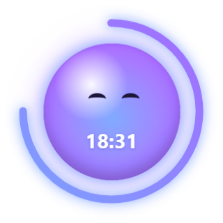

<p align="center">
  
</p>

<h1 align="center">Focus Orb</h1>

<p align="center">
  <b>A Pomodoro timer with a face.</b><br>
  It watches your screen with AI and, the moment you drift off to YouTube, flies to the middle of your screen and calls you out.
</p>

<p align="center">
  <a href="https://github.com/Terma9/focus-orb/actions/workflows/ci.yml"></a>
  <a href="https://github.com/Terma9/focus-orb/releases/latest"></a>
  
  
  
  
</p>

<p align="center">
  
</p>

## Features

- **Watches while you focus.** Every 3 s it asks OpenAI's [Decisions API](https://developers.openai.com/api/docs/guides/decisions) whether you're clearly distracted.
- **Calls you out, with a joke.** When you drift, the orb flies to the centre of your screen with a short, specific line. It keeps growing until you click **Back to work**.
- **Hard to annoy.** It only reacts when the AI is ≥ 80 % sure, twice in a row, for over 5 s. Docs, AI chats and dashboards count as work.
- **Learns what's work.** Wrong call? **This is work** approves that app, site or single video for the rest of your task.
- **Privacy mode.** Sends only window titles, never screenshots.
- **Focus score.** A summary card after every Pomodoro, then a 5-minute break where nothing is watched.

<table align="center">
  <tr>
    <td align="center"><br>Focusing</td>
    <td align="center"><br>You drifted</td>
    <td align="center"><br>Back on track</td>
    <td align="center"><br>On a break</td>
  </tr>
</table>

<!--
## In real life
<p align="center"></p>
-->

## Privacy

On first start the orb explains what it sends and lets you choose:

| | Full mode | Privacy mode |
|---|---|---|
| Sent to OpenAI every 3 s | Screenshot + window title | Window title only |
| Correct in testing (12 situations) | 12 / 12 | 11 / 12 |
| Cost per 25-min Pomodoro | ≈ $0.08 | ≈ $0.04 |

- **Never looked at, in either mode:** password managers, private/incognito windows and banking sites.
- **Nothing stored:** screenshots are never written to disk, and there are no analytics. Data goes only to OpenAI, with your own API key.

<p align="center">
  
</p>

## Get started

- **Try it without an API key:** `npm install`, then `npm run demo` plays the story above on a staged desktop.
- **Install:** download the installer from [Releases](https://github.com/Terma9/focus-orb/releases/latest). On first start it asks for your [OpenAI API key](https://platform.openai.com/api-keys) and stores it encrypted.
- **From source:** `npm install`, then `npm start` (the key can also go in `.env`; see [.env.example](.env.example) for all settings).

Type what you're working on and press Enter. Right-click the orb for break, stop, privacy mode and quit.

## How it works

<p align="center"></p>

- **Typed answers, not chat.** The Decisions API returns a probability for "is the user clearly distracted?", so there's no text to parse and the threshold can be tuned. The funny line comes from a single Responses API call, made only when you're caught.
- **"Distracted?", not "on task?"** Asking whether you're on task flagged AI chats and dashboards as distractions. Asking whether you're clearly distracted, with the benefit of the doubt for anything work-like, fixed that.
- **The window title is strong evidence.** It's read through the Win32 API (koffi FFI) and sent alongside the screenshot. That's also why privacy mode works almost as well.

## Engineering highlights

- **Smooth animation on a transparent window.** The alert window takes its full size once, while invisible, and the orb flies and grows with GPU-composited CSS transforms. An IPC handshake avoids flashes.
- **A self-recording demo.** `npm run record-demo` runs the scripted story off-screen and composites the transparent orb over a staged desktop. It encodes the GIF in Node with a shared palette, ordered dithering and unchanged-pixel transparency.
- **Tested logic.** 52 tests (node:test, no extra dependencies) cover:
  - the alert rules, focus score and "This is work" matching
  - the OpenAI requests (e.g. privacy mode never sends an image)
  - contracts between the page and the main process

  They reach 100 % line coverage of the logic modules and run in CI on every push.
- **Local models, measured.** Small open-weight models via Ollama judged window titles well (11 / 12), but screenshots took ~109 s per check on a laptop CPU, so the shipped version uses OpenAI.

## Development

```bash
npm test               # 52 unit tests
npm run test:coverage  # with a coverage report
npm run demo           # scripted demo, no API key needed
npm run record-demo    # re-record the GIF and README images (off-screen)
npm run dist           # build the Windows installer into dist/
```

## License

MIT, see [LICENSE](LICENSE). Changes are listed in [CHANGELOG.md](CHANGELOG.md).
