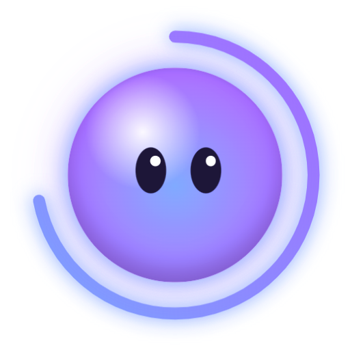
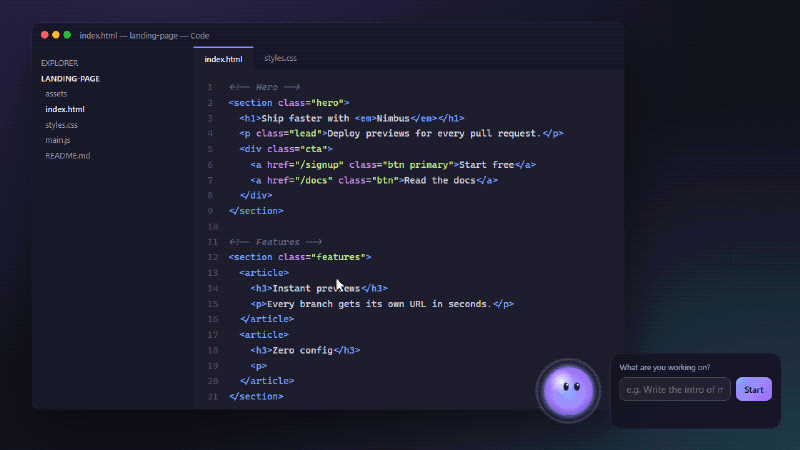
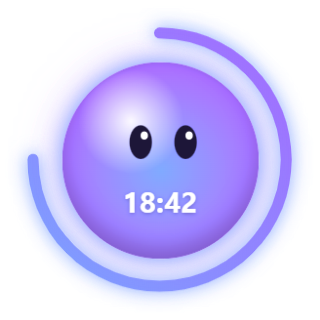
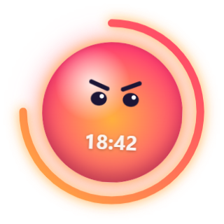
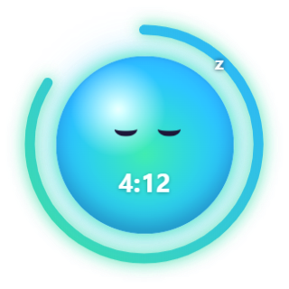
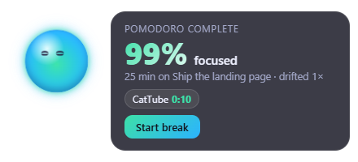
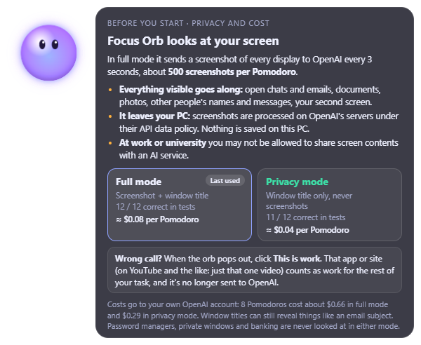
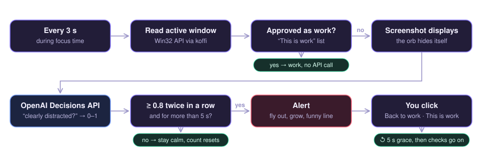

<p align="center">
  
</p>

<h1 align="center">Focus Orb</h1>

<p align="center">
  <b>A Pomodoro timer that notices when you drift off, and calls you out.</b>
</p>

<p align="center">
  <a href="https://github.com/Terma9/focus-orb/releases/latest"></a>
  <a href="#quick-start"></a>
  <a href="#how-it-works"></a>
</p>

<p align="center">
  <a href="https://github.com/Terma9/focus-orb/actions/workflows/ci.yml"></a>
  <a href="https://github.com/Terma9/focus-orb/releases/latest"></a>
  
</p>

<p align="center">
  
</p>

## Meet the orb

<table align="center">
  <tr>
    <td align="center" valign="top" width="33%"><br><b>Focusing</b><br>Sits in the corner with a 25-minute ring and follows your mouse.</td>
    <td align="center" valign="top" width="33%"><br><b>You drifted</b><br>Flies to the middle of your screen and grows until you're back.</td>
    <td align="center" valign="top" width="33%"><br><b>On a break</b><br>Sleeps through your 5-minute break. Nothing is watched.</td>
  </tr>
</table>

<p align="center">After every Pomodoro you get a focus score:<br><br></p>

- **Hard to annoy:** it only reacts when the AI is at least 80 % sure, twice in a row. Docs, AI chats and dashboards count as work.
- **Learns what's work:** wrong call? Click **This is work** and that app, site or video is fine for the rest of your task.
- **Privacy mode:** sends only window titles, never screenshots.

## Privacy

To notice that you drifted, Focus Orb has to see what you're doing, and that means information about your screen leaves your computer. You decide how much: on first start it explains everything below and lets you pick a mode.

### What is sent

| | Full mode | Privacy mode |
|---|---|---|
| **Every 3 s during a Pomodoro** | A screenshot of each display + the active window's title | Only the active window's title |
| **What that can include** | Everything visible: chats, emails, documents, photos, other people's names and messages, your second screen | Things like *"Funny cats – YouTube"*, but also an email subject or a document name |
| **Correct on normal websites** | 95 % | 93 % |
| **Correct when the title is vague** (*"Home"*, *"Messages"*) | 100 % | 60 % |
| **Cost per 25-min Pomodoro** | ≈ $0.08 | ≈ $0.04 |

**In short:** on normal websites, the window title is almost as good as a screenshot. Privacy mode's weak spot is vague titles: a social feed called *"Home"* or a chat called *"Messages"* looks harmless, so it gives you the benefit of the doubt and misses some distractions. It almost never flags real work by mistake. Measured on 55 hand-labelled situations, see [the full results](eval/results.md).

### Where it goes

Only to **OpenAI's API**, with **your own API key**, and it's processed there under OpenAI's API data policy. There's no server of mine in between, and no analytics or tracking.

### What never leaves your PC

- **Sensitive windows**, in both modes: password managers, private/incognito browser windows and banking sites are not screenshotted, and their titles aren't sent.
- **Approved pages:** anything you marked **This is work** is recognised locally, without asking OpenAI.
- **Time outside a Pomodoro:** before you start, during breaks and after you stop, nothing is watched.

### What is stored on your PC

- **No screenshots:** they only exist in memory for the one request.
- **Your API key:** encrypted with Windows' built-in protection (DPAPI).
- **Your choice of mode.**

> **At work or university?** Check whether you're allowed to share screen contents with an AI service. If you're unsure, use privacy mode.

<p align="center"></p>

## Quick start

**Download** the installer from [Releases](https://github.com/Terma9/focus-orb/releases/latest) and paste your [OpenAI API key](https://platform.openai.com/api-keys) on first start.

**Or run it from source.** The demo needs no API key:

```bash
git clone https://github.com/Terma9/focus-orb.git
cd focus-orb
npm install
npm run demo     # scripted demo on a staged desktop
npm start        # the real thing (asks for your API key)
```

## How it works

<p align="center"></p>

1. **It looks:** every 3 seconds it reads the title of the window you're using and takes a screenshot (or only the title in privacy mode).
2. **It asks one question:** OpenAI's [Decisions API](https://developers.openai.com/api/docs/guides/decisions) answers *"Is this person clearly distracted?"* with a probability from 0 to 1.
3. **It reacts carefully:** only at 0.8 or more, twice in a row, for over 5 seconds. A second AI call then writes the funny line.

## Under the hood

<details>
<summary><b>Design decisions</b></summary>

- **"Distracted?", not "on task?"** The first version asked whether the user was on task and flagged AI chats and dashboards as distractions. Flipping the question, and giving anything work-like the benefit of the doubt, fixed the false alarms. Videos are the exception: they count as distracting unless they're a hands-on tutorial for the task.
- **Typed answers instead of chat.** The Decisions API returns probabilities, not prose. There's nothing to parse, and the threshold can be tuned.
- **The window title is strong evidence.** It's read from Windows (Win32 API via koffi) on every check. That's why privacy mode, which sends nothing else, still gets 93 % of normal websites right.
- **Smooth animation on a transparent window.** Resizing the window every frame was jerky on Windows. The alert window now takes its full size once, while invisible, and the orb moves with GPU-accelerated CSS transforms.

</details>

<details>
<summary><b>How accuracy was measured</b></summary>

`npm run eval` judges 55 hand-labelled situations with the real AI and exactly the app's instructions, in both modes, 3 times each (about 330 checks, a few cents). The situations cover three tasks: building this app, writing a thesis on climate policy, and preparing marketing slides.

- **40 real websites,** screenshotted fresh on every run: docs, GitHub, papers, design tools, YouTube, Reddit, Twitch, shops, sports, games. They include tricky ones, like a YouTube tutorial for the task or a serious but unrelated Wikipedia article.
- **15 self-made screens with vague titles,** e.g. a social feed titled *"Home"* or a chess game titled *"Play"*. Here only the screenshot shows what's going on.

| | Full mode | Privacy mode |
|---|---|---|
| Correct, all 55 | **96 %** | **84 %** |
| Correct, 40 real websites | 95 % | 93 % |
| Correct, 15 vague titles | 100 % | 60 % |
| Work wrongly flagged | 2 of 27 | 1 of 27 |
| Distractions missed | 0 of 28 | 8 of 28 |
| Same answer in all 3 runs | 55 of 55 | 55 of 55 |
| Time per check | 0.3 s | 0.1 s |

What it shows:

- **Full mode** missed no distraction. Its two false alarms were debatable: arXiv papers on atmospheric *physics* while writing about climate *policy*, and a general "how to present" video while making slides.
- **Privacy mode** errs on the gentle side. It misses distractions when the title doesn't reveal them, but almost never flags real work.
- **Neither mode wobbles:** every situation got the same verdict in all three runs.

Every situation and verdict is listed in [eval/results.md](eval/results.md). This is a hand-made check, not a benchmark, and it's separate from the 52 automated code tests below.

</details>

<details>
<summary><b>Tests</b></summary>

52 automated code tests (separate from the accuracy check above) with Node's built-in test runner, 100 % line coverage of the logic modules, run by GitHub Actions on every push. They cover:

- the alert rules: threshold, streak, grace period, snooze
- the focus score
- what "This is work" remembers
- the never-look list
- the exact requests sent to OpenAI (for example, privacy mode never sends an image)
- contract checks between the visible page and the main process

</details>

<details>
<summary><b>How the demo GIF is made</b></summary>

`npm run record-demo` plays a scripted story in windows placed off-screen, so your own screen is never touched. It captures the transparent orb frame by frame and composites it over a staged desktop with a made-up video site. Then it encodes the GIF in Node, keeping it small (≈ 2 MB) with a shared colour palette and by storing only the pixels that change.

</details>

<details>
<summary><b>Experiment: local AI instead of OpenAI</b></summary>

I tested small open-weight models via Ollama on a laptop CPU. Judging window titles worked well (11 of the first 12 test situations, ~1 s per check). Screenshots took ~109 s per check, far too slow for checks every few seconds, so the app uses OpenAI.

</details>

<details>
<summary><b>Development</b></summary>

```bash
npm test               # unit tests
npm run test:coverage  # with coverage report
npm run record-demo    # re-record the GIF and README images
npm run dist           # build the Windows installer
```

Settings such as Pomodoro length and strictness are listed in [.env.example](.env.example). Changes are listed in [CHANGELOG.md](CHANGELOG.md).

</details>

---

<p align="center">
  Built with Electron, OpenAI's Decisions and Responses APIs, and plain JavaScript · <a href="LICENSE">MIT License</a>
</p>
